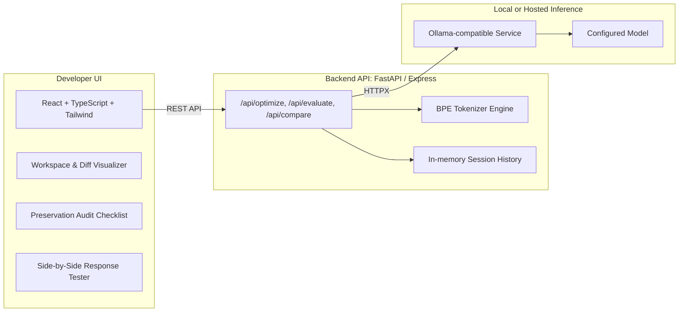

# Promptora — Open-Source AI Prompt Optimizer

> **"Say more with less."**  
> *Trim the noise. Keep the meaning.*

Promptora is a developer tool and open-source engine for optimizing, compressing, and validating large language model prompts. Powered locally by **Ollama** and **Gemma 3: 4B**, Promptora removes verbose filler, boilerplate, and pleasantries from your prompts while preserving every technical constraint, instruction, and output requirement.

---

## Architecture



---

## Problem Statement

As AI prompts grow into multi-paragraph system prompts with rules, schemas, and examples, they consume valuable context window tokens, introduce latency into agentic loops, and inflate inference costs. 

However, simply "shortening" a prompt often leads to lost constraints, hallucinated parameters, or altered output formatting.

**Promptora solves this with measurable prompt optimization:**
1. **Measured Compression**: Accurately measures token reduction (`reduction % = ((orig - opt) / orig) * 100`).
2. **Meaning Preservation Check**: Analyzes requirements before and after, classifying each requirement as *Preserved*, *Possibly Changed*, or *Missing*.
3. **Before-and-After Response Testing**: Runs both versions through your local model to observe real-world output side-by-side.
4. **Local-first by default**: In local mode, prompts are sent only to your self-hosted Ollama service. On Vercel, prompts are sent through the hosted API to the configured remote Ollama-compatible service.

---

## Features

- **3 Optimization Modes**:
  - `Light`: Removes only obvious fluff and repetition, preserving original phrasing.
  - `Balanced`: Simplifies complex sentences and strips wordiness while maintaining natural structure.
  - `Aggressive`: Condenses to essential instruction cores, removing passive voice and conversational framing.
- **Structural Constraints Lock**: Strictly preserves Markdown tables, code blocks, JSON schemas, and variable names.
- **Accurate Token Metrics**: Real-time token counts, character counts, word counts, execution latency, and savings percentage.
- **Meaning Preservation Matrix**: Heuristic requirement extractor auditing instruction retention with actionable warnings.
- **Dual Response Runner**: Directly test task fulfillment by running both prompts against the selected model side-by-side.
- **Productivity & History**: One-click prompt copying, "Replace Original" iterative refinement, `.txt`/`.md` exports, and session history.
- **Health & Diagnostics**: Real-time Ollama status prober, model detection, and copyable terminal repair commands.

---

## Technology Stack

- **Frontend**: React 19, TypeScript, Tailwind CSS v4, Lucide React icons, Motion animations.
- **Backend**: Python 3.10+, FastAPI, HTTPX, Pydantic v2 (and Express.js full-stack bridge for instant web applet preview).
- **Inference**: Ollama (`http://localhost:11434`), default model `gemma3:4b`.

---

## Prerequisites & Installation

### 1. Install Ollama
Download and install Ollama from [https://ollama.com](https://ollama.com).

### 2. Pull the Default Model
Open your terminal (PowerShell, Command Prompt, or Bash) and run:
```bash
ollama serve
ollama pull gemma3:4b
```

*(Optional: You can also use `llama3.2`, `mistral`, `qwen2.5:7b`, or any model installed in your Ollama library).*

---

## Windows Setup Instructions

### Option A: Run the Python FastAPI API

This starts the standalone API on port 8000. The React frontend currently uses the Express API in Option B, so starting FastAPI alone does not connect it to the web UI.

```powershell
# Create and activate a Python virtual environment
python -m venv venv
.\venv\Scripts\Activate.ps1

# Install Python dependencies
pip install -r backend/requirements.txt

# Start the API (interactive docs are available at http://localhost:8000/docs)
uvicorn backend.main:app --reload --port 8000
```

### Option B: Run the web app with its Express API

```powershell
npm install
npm run dev
```
Open `http://localhost:3000` in your browser. This server provides both the Vite frontend and the `/api` routes used by the UI.

### Option C: Public Vercel deployment

Vercel hosts the React site and Express API as a serverless function; it does **not** run an Ollama daemon. Configure a remotely reachable Ollama-compatible endpoint before deploying. The endpoint must be reachable from Vercel and should use HTTPS and authentication. Do not expose an unauthenticated Ollama port directly to the public internet.

1. Create a Clerk application and an Upstash Redis database.
2. Import the project repository in Vercel. Keep the project root at the repository root; `vercel.json` sets the Vite build output and API routing.
3. Add these environment variables in Vercel project settings for each environment you will deploy:

   | Variable | Value |
   |---|---|
   | `VITE_DEPLOYMENT_MODE` | `hosted` |
   | `VITE_CLERK_PUBLISHABLE_KEY` | Clerk publishable key (`pk_...`) |
   | `CLERK_PUBLISHABLE_KEY` | Same Clerk publishable key |
   | `CLERK_SECRET_KEY` | Clerk secret key (`sk_...`) |
   | `UPSTASH_REDIS_REST_URL` | Upstash Redis REST URL |
   | `UPSTASH_REDIS_REST_TOKEN` | Upstash Redis REST token |
   | `OLLAMA_BASE_URL` | Base URL of your remote Ollama-compatible service |
   | `OLLAMA_MODEL` | Model available from that service |
   | `OLLAMA_API_KEY` | Optional bearer token, if required by that service |

4. Deploy, sign up, then check the health status and run an optimization. Vercel builds the frontend with `npm run build`; the API function handles `/api/*`.

Authenticated accounts are limited to **10 API requests per minute and 100 per day**. Rate limits use Upstash Redis and are shared across serverless instances. The latest 10 history items are isolated per account in function memory, so history is temporary and may disappear between requests or deployments.

**Hosted privacy note:** Vercel and the configured model host process prompts sent to the hosted app. Do not use the local-only privacy claims above for a deployed instance.

> **Windows CORS Note**: If Ollama refuses connections from the browser, set the environment variable:
> ```powershell
> $env:OLLAMA_ORIGINS="*"
> ollama serve
> ```

---

## Environment Variables

Copy `.env.example` to `.env`:

| Variable | Default Value | Description |
|---|---|---|
| `OLLAMA_BASE_URL` | `http://localhost:11434` | Ollama daemon API URL |
| `OLLAMA_MODEL` | `gemma3:4b` | Default local language model |
| `MAX_PROMPT_LENGTH` | `25000` | Maximum prompt characters allowed |
| `OLLAMA_TIMEOUT_SECONDS` | `90.0` | Inference timeout for local GPU/CPU |

The Clerk and Upstash variables listed above are required for Vercel's public API. Keep secret keys in Vercel server-side environment variables; never add them to `VITE_*` variables or commit them.

---

## API Documentation

- `GET /api/health` — Probes Ollama connectivity, checks if `gemma3:4b` is pulled.
- `GET /api/models` — Lists locally installed models.
- `POST /api/optimize` — Compresses prompt and calculates token metrics.
- `POST /api/evaluate` — Audits requirement preservation (Preserved, Changed, Missing).
- `POST /api/compare` — Runs original and optimized prompts side-by-side.
- `GET /api/history` — Fetches recent prompt sessions.
- `DELETE /api/history/{id}` — Deletes a history entry.

---

## Running Automated Tests

Run the test suite using pytest with mocked Ollama endpoints:

```bash
pytest tests/ -v
```

The test suite validates:
- Empty and invalid prompts
- Successful optimization
- Token reduction calculation accuracy
- Negative token savings on expanded prompts
- Model missing and timeout exceptions
- Requirement-preservation classification

---

## Limitations

- **Heuristic Equivalence**: While the Meaning Preservation Check detects missing constraints, it is not formal mathematical proof of equivalence. Mission-critical prompts should always undergo human review.
- **Model Dependent**: Compression quality depends on the reasoning capability of your local model. `gemma3:4b` offers an ideal speed-to-quality ratio on standard laptops.
- **Hardware Latency**: On machines without dedicated GPUs, local inference may take 5–15 seconds per run.

---

## Roadmap

- [ ] Automated regression test harness comparing response quality across 100 sample prompts.
- [ ] Export directly to `.env` or LangChain / LlamaIndex prompt templates.
- [ ] Direct token count lookup via native SentencePiece tokenizer bindings.
- [ ] Interactive token-level diff visualizer with color-coded deletions.

---

## License

Promptora application source code is distributed under the [MIT License](LICENSE).  
Ollama and model weights (Gemma 3, Llama) are subject to their respective creators' licenses.
