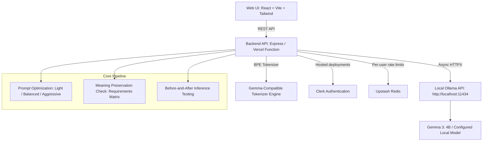

# Promptora System Architecture

Promptora is an open-source AI prompt optimization and evaluation suite designed to compress verbose prompts while helping verify semantic fidelity.

## Pipeline Components

### 1. Token Estimation Engine
- Computes token counts using a Gemma-compatible BPE tokenizer approximation.
- Evaluates token difference and percentage reduction:
  $$\text{reduction\_percentage} = \frac{\text{original\_tokens} - \text{optimized\_tokens}}{\text{original\_tokens}} \times 100$$
- Safely handles edge cases (zero tokens, negative savings if prompt expands).

### 2. Prompt Optimization Engine
- Transcribes verbose prompts into condensed, high-signal instructions.
- Enforces three compression strengths: Light, Balanced, Aggressive.
- System prompt forces the model to rewrite, avoid preambles, and preserve all structured schemas.

### 3. Meaning Preservation Inspector
- Extracts granular requirements (instructions, constraints, formatting rules, roles, safety boundaries).
- Cross-references the optimized prompt and classifies each item as `preserved`, `possibly_changed`, or `missing`.
- Produces clear audit checklists with honest disclaimers.

### 4. Before-and-After Model Testing
- Executes both the original and optimized prompt under identical sampling conditions ($T=0.7$).
- Measures execution latency and response length side-by-side.
- User-initiated verification to safeguard against prompt drift.
